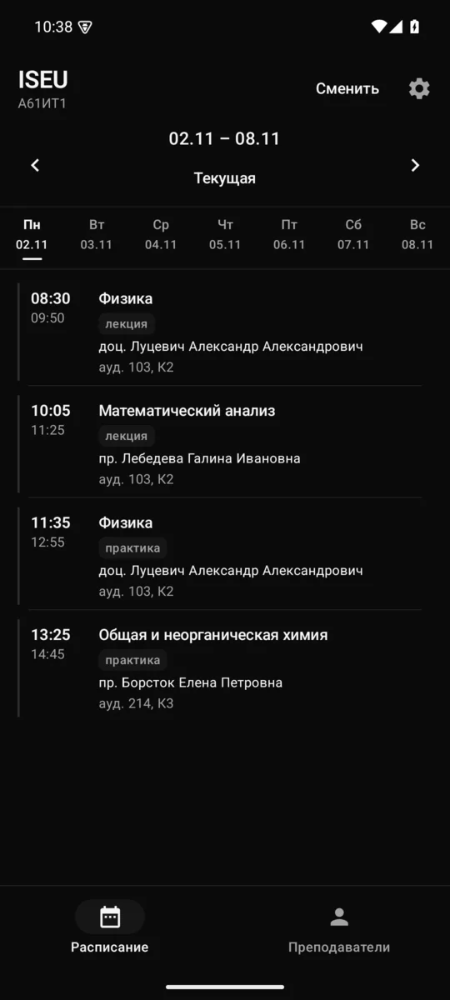
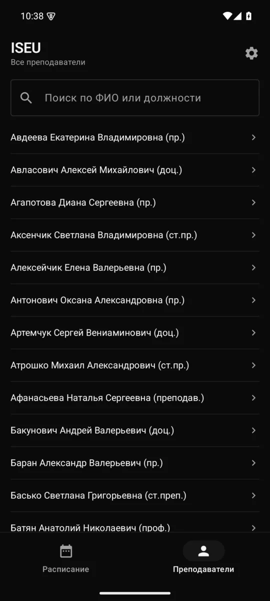
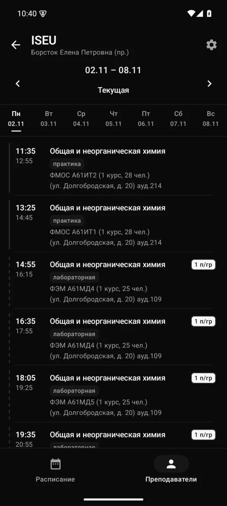

# ISEU — расписание занятий

<p align="center">
  
  
  
</p>

<p align="center">
  Расписание группы · Преподаватели · Расписание преподавателя
</p>

Лёгкое Android-приложение с расписанием Международного государственного
экологического института им. А. Д. Сахарова (БГУ). Работает напрямую с
сайтом `rsp.iseu.by`: без аккаунтов, уведомлений, аналитики и собственного
сервера. Интернет нужен только для загрузки; последние недели и каталог
остаются доступны из кэша.

> Неофициальный клиент. Не связан с институтом; данные расписания
> принадлежат университету.

## Возможности

- Расписание группы: факультет → форма обучения → курс → группа.
- Отдельная вкладка «Преподаватели» со списком всех преподавателей и
  поиском по ФИО или должности. Сохранённая группа при просмотре не
  меняется.
- Дни недели переключаются вкладками или свайпом влево/вправо. Для
  текущей недели открывается сегодняшний день, для остальных —
  понедельник.
- Навигация по неделям, выделение текущего дня, кнопка «Текущая».
- Подгруппы помечаются бейджем и пунктирной линией; фильтра нет.
- Системный жест «Назад» возвращает из расписания преподавателя к
  списку, из списка — к расписанию группы, а из выбора цели отменяет
  выбор вместо закрытия приложения.
- Офлайн-кэш последних загруженных недель и каталога.
- Монохромная светлая и тёмная тема, выбор темы в настройках.
- `minSdk 24` (Android 7.0), `targetSdk 35` (Android 15).

## Как это работает

Сайт ISEU — ASP.NET WebForms без JSON API. Приложение повторяет цепочку
постбэков с `__VIEWSTATE`/`__EVENTVALIDATION`, поддерживает cookie-сессию
и разбирает `table#TT` через Jsoup. Нормализованные занятия складываются в
Room, выбранная группа и тема — в DataStore.

HTTPS у сайта невалиден, поэтому cleartext HTTP разрешён только для
`rsp.iseu.by` (`app/src/main/res/xml/network_security_config.xml`).
Остальной трафик приложения ограничен этим доменом.

Архитектура — одностраничное Compose-приложение с MVVM и `StateFlow`.
Навигация ручная: корневой экран показывает либо выбор цели, либо
расписание, либо настройки.

## Сборка

Нужны JDK 17 и Android SDK 35. Путь к SDK задаётся через `ANDROID_HOME`
или `local.properties` (файл не хранится в репозитории).

```bash
./gradlew :app:testDebugUnitTest
./gradlew :app:assembleDebug
```

Debug APK: `app/build/outputs/apk/debug/app-debug.apk`.

```bash
adb install -r app/build/outputs/apk/debug/app-debug.apk
```

Release-сборка:

```bash
./gradlew :app:assembleRelease
```

R8 включает минификацию и удаление неиспользуемых ресурсов; APK занимает
около 1.8 МБ. В текущей конфигурации release подписывается debug-ключом
машины разработчика (см. `app/build.gradle.kts`) — для собственного
распространения настройте отдельный keystore.

Вспомогательный `scripts/env.sh` задаёт пути к JDK, SDK и Gradle на
машине автора; его можно не использовать.

## Тесты

Юнит-тесты покрывают разбор каскада и таблиц, HTTP-сессию, кэш,
`WeekSelector` и ViewModel. Фикстуры реальных страниц лежат в
`app/src/test/resources/fixtures/`.

```bash
./gradlew :app:testDebugUnitTest
```

Живая проверка парсера на настоящем сайте (по умолчанию пропускается):

```bash
ISEU_LIVE=1 ./gradlew :app:testDebugUnitTest --tests '*LiveFetchTest*'
```

## Структура

```text
app/src/main/java/by/iseu/schedule/
├── data/
│   ├── network/   HTTP-сессия ASP.NET, cookies
│   ├── parser/    каскад выбора и разбор table#TT
│   ├── db/        Room: кэш каталога и недель
│   ├── prefs/     DataStore: группа, преподаватель, тема
│   └── repo/      загрузка, кэширование, проверка актуальности
├── ui/
│   ├── schedule/  расписание, вкладки дней, преподаватели
│   ├── select/    выбор группы или преподавателя
│   ├── settings/  тема и сброс кэша
│   └── theme/     монохромная тема Material 3
├── IseuApp.kt
└── MainActivity.kt
```

## Ограничения

- Нет уведомлений, виджетов и фонового обновления.
- Нет своего бэкенда: при недоступности сайта показывается кэш.
- Разметка сайта может измениться; в этом случае парсер вернёт понятную
  ошибку, а кэш не затрётся.
- Значения факультетов и групп меняются каждый семестр и читаются с сайта
  динамически.

## Стек

Kotlin 2.1, Jetpack Compose, Material 3, OkHttp, Jsoup, Room, DataStore,
kotlinx.serialization, Coroutines. Core library desugaring для `java.time`
на API 24–25.

## Источник данных

- Группы: <http://rsp.iseu.by/Raspisanie/TimeTable/umu.aspx>
- Преподаватели: <http://rsp.iseu.by/Raspisanie/TimeTable/umuteachers.aspx>

## Благодарности

Идеи и разбор сайта подсмотрены в Telegram-ботах:

- [sl0vvman/isei-schedule-bot](https://github.com/sl0vvman/isei-schedule-bot)
- [koalko99/isei-schedule](https://github.com/koalko99/isei-schedule)
